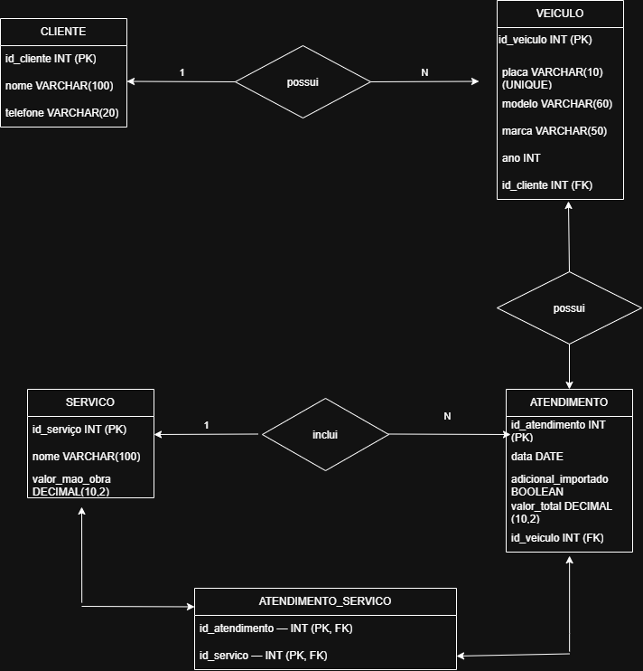

# Sistema Osvaldo Motors

Este repositório apresenta o projeto criado para a oficina Osvaldo Motors.

O sistema foi pensado para ajudar na organização dos atendimentos da oficina, permitindo cadastrar dados dos clientes e de seus veículos, registrar os serviços executados e consultar os preços.

A proposta é facilitar o acompanhamento dos reparos, manter as informações organizadas e contribuir para um gerenciamento mais prático e eficiente das atividades da oficina.!

## Diagrama do Banco de Dados (DER)

